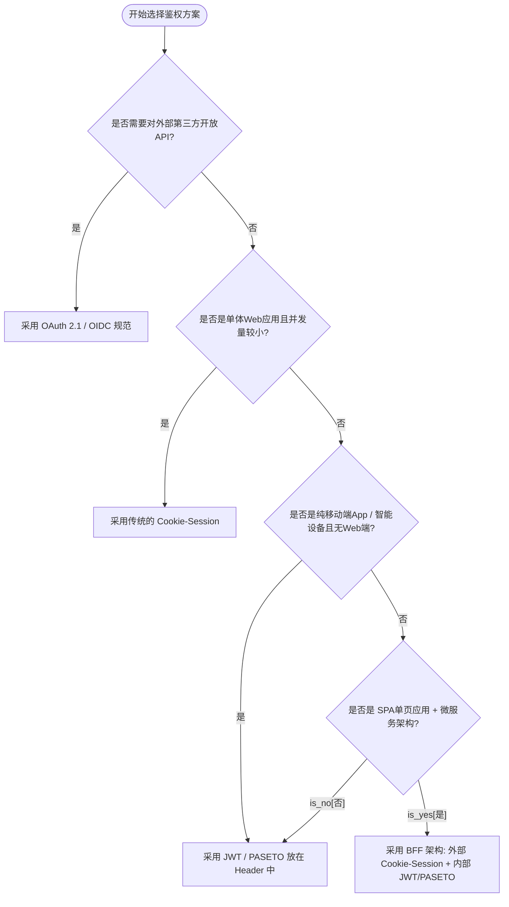

# 后端鉴权技术演进：从 Session/Cookie 到 JWT、OAuth 2.0

**研究对象**：后端鉴权技术与协议（Session/Cookie, JWT, OAuth 2.0, OIDC 及现代演进）  
**研究方法**：横纵分析法（纵向时间轴演进史 + 横向多维度技术对比 + 横纵交汇趋势研判）  

---

## 一、 纵向分析：后端鉴权的历史长卷与决策史诗

后端鉴权（Authentication & Authorization）的演进史，本质上是**互联网应用架构（单体 -> 分布式 -> 微服务 -> 云原生/网关化）与客户端形态（Web浏览器 -> 移动端App -> 第三方开放平台 -> IoT）演进的缩影**。这并不是一段冷冰冰的标准协议发布年表，而是一代代工程师在性能、安全、便利性与架构解耦之间不断妥协、博弈与妥协的史诗。

### 1. 起源追溯：被“无状态”逼出来的状态保留（1994年 - 2000年代初）

#### 诞生的时代背景
1990年代初，万维网（World Wide Web）刚刚兴起。蒂姆·伯纳斯-李（Tim Berners-Lee）设计的 HTTP 协议（HTTP/1.0 及后续的 HTTP/1.1）被设计为**无状态（Stateless）**的。这意味着服务器处理的每一次请求都是完全孤立的，它并不知道“当前请求”和“上一次请求”是不是同一个用户发送的。

对于早期的静态网页浏览，无状态协议具有极高的效率和扩展性。然而，随着电子商务（如亚马逊、eBay）和交互式 Web 应用的诞生，问题接踵而至：用户一旦登录，或者把商品放进购物车，刷新页面后状态就丢失了。服务器无法“记住”用户。

#### Cookie 的诞生（1994）
为了解决这个问题，1994 年，网景公司（Netscape）的年轻程序员**卢·蒙特利（Lou Montulli）**在开发一个电子商务购物车应用时，提出了 **Cookie** 的概念。他在浏览器的客户端设计了一个微型的本地数据库，服务器可以在响应头中通过 `Set-Cookie` 指令，命令浏览器保存一小段文本，并在随后的每一次请求中都自动附带上这段文本。

```
+------------+                 HTTP 请求 (无状态)                 +------------+
|            | ------------------------------------------------> |            |
|            |                                                   |   Server   |
|   Client   | <------------------------------------------------ |            |
| (Browser)  |           HTTP 响应 (带 Set-Cookie: SID=123)       +------------+
|            |                                                         |
| 存储 Cookie|                                                         v
|  SID=123   |                                                   创建 Session
|            |                 携带 Cookie: SID=123                    |
|            | ------------------------------------------------> | 验证 SID=123|
+------------+                                                   +------------+
```

1997年，IETF 正式发布了第一个 Cookie 规范——**RFC 2109**。从此，基于 **Cookie-Session** 的状态管理方案统治了 Web 开发整整二十年。

#### 最初的形态与决策逻辑
在单体应用（Monolithic）时代，**Cookie-Session** 是完美的解法。
- **内存 Session**：服务器在内存中维护一个全局的 Session 哈希表，Key 是随机生成的无规律字符串（Session ID / SID），Value 是存储用户登录信息（如用户名、权限、购物车）的结构体。
- **安全性**：Session ID 被写入浏览器的 Cookie，并被打上 `HttpOnly`（防 XSS 跨站脚本读取）和 `Secure`（仅在 HTTPS 下传输）标记。敏感数据全部留在服务器端，客户端只有一个“无意义的门票（SID）”。

这一时期也存在过极简的 **HTTP Basic Authentication（RFC 2617）** 方案（即每次请求都在 `Authorization` 请求头中携带 `Base64(username:password)`），但由于每次都暴露明文密码、无法优雅注销且用户体验极差，迅速被限制在企业内部网络或极简单的 API 场景中。

---

### 2. 互联网爆发与 API 浪潮：OAuth 1.0 的挣扎与妥协（2006年 - 2010年）

#### 跨系统集成的痛点与反模式
进入 2000 年代中后期，Web 2.0 时代到来。Flickr、Twitter、Google 等平台迅速崛起。用户不仅在单一网站上活动，还希望**不同的网站/应用之间能够互相读取数据**。例如，一个叫“照片打印服务”的第三方网站，希望读取用户在 Flickr 上的相册；或者一个桌面的 Twitter 客户端，希望代表用户发布推文。

在当时，由于缺乏统一的授权协议，行业里充斥着极其危险的**“反模式”（Anti-patterns）**：
* 第三方软件直接要求用户输入 Flickr 或 Twitter 的**真实账号和密码**。
* 第三方软件拿到密码后，以用户本人的身份登录，进行“屏幕刮擦”（Screen Scraping）或调用接口。

这种模式的危害是显而易见的：
1. **密码泄露**：第三方软件可能恶意存储或泄漏用户密码。
2. **权限过大**：第三方软件获得了用户的完整控制权，无法限制其只能读取相册而不能删除账号。
3. **撤销困难**：用户想要取消第三方的访问权限，必须修改自己的主密码，这会导致所有其他授权的第三方软件全部失效。

#### OAuth 1.0 的诞生（2007）
为了解决“免去密码分享的授权”问题，2007 年，Twitter 的**布莱恩·库克（Blaine Cook）**与来自 Google、Flickr 等公司的工程师自发成立了一个工作组，共同草拟了 **OAuth 1.0** 协议，并于 2010 年正式收录为 **RFC 5849**。

OAuth 1.0 的核心逻辑是引入了一个**“三方委托授权”流程**。它不再传递密码，而是通过一系列复杂的签名步骤，向第三方应用发放一个代表特定访问权限的 `AccessToken`。

```
+-------------+      (A) 申请 Request Token       +---------------+
|             | --------------------------------> |               |
|             |      (B) 授权并重定向回来         |               |
| Third-party | <-------------------------------- | Authorization |
|    App      |      (C) 兑换 Access Token        |    Server     |
|             | --------------------------------> |               |
|             |      (D) 发放 Access Token        |               |
|             | <-------------------------------- +---------------+
+-------------+
```

#### 决策背后的技术约束与痛点
虽然 OAuth 1.0 解决了密码泄露的问题，但它在实际落地中遇到了巨大的工程灾难：
* **极其复杂的签名算法（Cryptographic Signatures）**：OAuth 1.0 诞生时，全网 HTTPS（TLS）的普及率极低。为了防止请求在传输中被篡改或窃听，OAuth 1.0 要求客户端在发送每一次 API 请求时，都必须把请求的 HTTP 方法、URL、所有查询参数、以及 Header，结合 `Consumer Secret` 和 `Token Secret`，使用 HMAC-SHA1 算法计算出一个极其复杂的数字签名（`oauth_signature`）。
* **开发者苦不堪言**：只要请求中多了一个空格、或者参数排序稍有不一致，签名就会校验失败。对于刚刚兴起的移动端开发（iOS、Android）和前端 JavaScript（浏览器）环境，编写和维护这一套签名逻辑简直是噩梦。

---

### 3. OAuth 2.0 的“地狱之路”与 JWT 的横空出世（2011年 - 2015年）

针对 OAuth 1.0 的痛点，IETF 展开了 OAuth 2.0 的起草工作，旨在抛弃复杂的客户端签名，极大地简化协议。

#### OAuth 2.0 协议的波折（2012）
2012 年 10 月，**RFC 6749 (OAuth 2.0 Framework)** 和 **RFC 6750 (Bearer Token)** 正式发布。然而，在发布前夕，OAuth 2.0 的主要起草人兼主编 **埃兰·哈默（Eran Hammer）** 宣布从起草小组中辞职，并从起草者名单中删除了自己的名字。

Eran Hammer 写下了一篇著名的博客 **《OAuth 2.0 and the Road to Hell》**。他在文中抨击道：
> “OAuth 2.0 已经从一个简洁、安全、专注于 Web 场景的协议，变成了一个为了取悦各大企业利益、充斥着各种妥协和无限扩展选项的‘庞杂框架’。它抛弃了签名，完全依赖 TLS（HTTPS）提供安全性，使得安全性完全依赖于实施者的水平。这必将导致大量的安全漏洞。”

事实证明，Eran Hammer 的预言非常准确。OAuth 2.0 取消了复杂的签名，取而代之的是 **Bearer Token（持有者令牌）**：只要谁拿到了这个 Token，谁就能直接访问资源，无需任何签名证明。这使得客户端的开发工作量暴跌 90%，但同时也让 Token 的传输和存储安全变得极其敏感。此外，为了照顾不同的场景， OAuth 2.0 一口气定义了四种核心授权模式（Grant Types）：
1. 授权码模式（Authorization Code）
2. 简化模式（Implicit）
3. 密码模式（Resource Owner Password Credentials）
4. 客户端凭证模式（Client Credentials）

#### 微服务架构与 JWT 的绝配（2011 - 2015）
与此同时，互联网的技术架构发生了翻天覆地的变化。**单体应用开始向微服务（Microservices）演进**。

在传统的 Cookie-Session 架构下，微服务面临着巨大的伸缩性瓶颈：
* **Session 同步地狱**：如果服务 A、B、C 都要知道当前用户是谁，他们必须共享一个 Session 存储（如 Redis）。每次 API 请求，微服务都必须进行一次 Redis 读取，网络 I/O 成了性能瓶颈。
* **跨域限制**：在分布式场景下，不同的服务可能部署在不同的域名下（如 `api.foo.com` 和 `api.bar.com`），浏览器的 Cookie 同源策略（Same-Origin Policy）给多域名状态共享带来了巨大麻烦。

在这个背景下，IETF 的 JOSE（JSON Object Signing and Encryption）工作组开始推动一种新的令牌格式——**JWT（JSON Web Token）**，并于 2015 年发布了 **RFC 7519**。

JWT 的设计思想是**“无状态（Stateless）与自包含（Self-contained）”**：
1. 它将用户的身份信息（User Claims，如用户 ID、角色、过期时间）序列化为 JSON。
2. 使用 Base64Url 进行编码。
3. 服务端使用私钥或共享密钥，对这串数据进行签名（如 HMAC-SHA256 或 RSA），并将签名拼在尾部。

```
JWT 结构：
[Header: 算法与类型] . [Payload: 身份声称数据] . [Signature: 签名防止篡改]
```

当客户端发起请求时，只需要在请求头中携带：
`Authorization: Bearer <JWT>`

每个微服务在拿到这个 JWT 后，**不需要去数据库或 Redis 查询 Session**，只需要使用手中的公钥或密钥在本地验证签名的有效性，然后直接解码 Payload 即可获取用户信息。这种“去中心化”的校验机制极大地解放了微服务的横向扩展能力。

---

### 4. 身份乱局与 OIDC 的救赎（2014年）

#### 授权（Authorization）与身份验证（Authentication）的混淆
随着 OAuth 2.0 的普及，各大技术巨头（Facebook, Google, 微博, 微信）纷纷推出“使用某某账号登录”。开发者们很自然地想：既然我能通过 OAuth 2.0 拿到一个指向用户信息的 Access Token，那我直接用这个 Token 作为用户的登录凭证不就行了？

这就陷入了**“将授权协议当成身份验证协议”的巨大误区（Authentication-over-OAuth Anti-pattern）**：
* **Access Token 的本质是“钥匙”**。它是一串不透明的字符，用来证明“持有者拥有访问某资源的权限”。客户端无法从 Access Token 本身知道“是谁”在什么时间登录的。
* **安全漏洞（Token 替换攻击）**：恶意的第三方应用可以将发给自己应用的 Access Token 欺骗性地发送给另一个应用，如果该应用仅凭 Token 的存在就确认用户身份，就会导致账号被黑客接管。

#### OIDC 规范的诞生（2014）
为了彻底纠正这个乱象，2014 年 2 月，**OpenID Foundation（OIDF）** 联合 Google、微软、Salesforce 等巨头发布了 **OpenID Connect (OIDC) 1.0**。

OIDC 并没有推翻 OAuth 2.0，而是**在 OAuth 2.0 的基础上做了一个极其轻量级的身份层（Identity Layer）**：
* 引入了 **ID Token**：它必须是 JWT 格式，里面有规范化（Standard Claims）的身份字段（如 `sub` 唯一标识、`iss` 发行方、`auth_time` 验证时间）。
* 增加了 **UserInfo Endpoint**：一个标准的接口，用于使用 Access Token 获取当前登录用户的详细 Profile。
* 定义了统一的发现机制（Discovery Metadata），使得客户端可以自动化地配置认证参数。

```
OIDC = OAuth 2.0 (授权) + ID Token (身份认证, JWT 格式) + 标准化接口与流
```

---

### 5. 现代演进：零信任、API 网关与安全收紧（2018年 - 至今）

进入云原生时代，鉴权技术在安全风控和架构整洁度上进入了更深层次的重构。

#### 1. OAuth 2.1 协议的整合与收紧
鉴于 OAuth 2.0 过于宽松导致的各种漏洞，IETF 自 2020 年起开始起草 **OAuth 2.1**。它的核心逻辑是**“去粗取精，强制安全”**：
* **废除 Implicit（简化）模式**：因为这种模式直接在 URL 中返回 Access Token，极易被浏览器历史记录、反向代理日志泄漏或被劫持。
* **废除 Resource Owner Password Credentials（密码）模式**：不允许客户端直接接触用户的用户名和密码。
* **强制使用 PKCE（Proof Key for Code Exchange）**：即使是传统的授权码模式，也必须使用 PKCE，以防止授权码在传输中被拦截和替换。
* **默认只允许 HTTPS**。

#### 2. 浏览器存储安全与 BFF（Backend For Frontend）架构的兴起
在 SPA（单页应用）时代，开发者习惯于将 JWT 存储在浏览器的 `localStorage` 中。然而，一旦网站遭受 **XSS（跨站脚本攻击）**，恶意脚本可以轻易读取 `localStorage` 中的 JWT 并发送到黑客的服务器。这种泄漏是无法挽回的，因为 JWT 默认是无状态的，无法被轻易撤销。

为了解决这个问题，现代微服务架构开始向 **BFF（服务于前端的后端）** 演进：
* 浏览器不直接与后端的微服务通信，也不持有任何 JWT/Access Token。
* 浏览器与 BFF 之间保持传统的、安全的 **Cookie-Session** 通信，Cookie 被设置为 `HttpOnly`, `Secure` 和 `SameSite=Lax/Strict`，最大程度免疫了 XSS 和 CSRF 攻击。
* BFF 作为一个受信任的网关，在内存中维护会话，并在向底层微服务转发请求时，将 Session 转换为内部的 **JWT/OAuth Token**。

#### 3. 去中心化鉴权协议的诞生
JWT 由于过于宽松的签名算法支持（甚至支持 `none` 算法，即不签名，导致了历史上多次著名的安全绕过漏洞），被部分安全专家所诟病。这推动了 **PASETO（Platform-Agnostic Security Tokens）** 的提出。PASETO 移除了加密算法协商机制，只提供有限的、安全的加密密码套件，从根本上杜绝了因加密算法配置错误导致的漏洞。

---

## 二、 横向分析：主流后端鉴权方案的多维度大阅兵

在本节中，我们将目前最主流的五种鉴权方案——**传统 Cookie-Session**、**无状态 JWT**、**OAuth 2.0 / OIDC**、**新型安全令牌 PASETO** 以及 **网关/BFF 混合架构** 进行全方位的横向剖析。

### 1. 技术架构与核心逻辑对比

| 维度 | Cookie-Session (有状态) | JWT (无状态) | OAuth 2.0 / OIDC (授权/身份) | PASETO (安全改良令牌) | BFF + API 网关 (混合架构) |
| :--- | :--- | :--- | :--- | :--- | :--- |
| **底层逻辑** | 服务器内存/Redis 维护会话状态，客户端仅持有 ID。 | 客户端持有自包含且带签名的 JSON 数据，服务器本地校验。 | 委托代理授权与标准身份协议，区分角色与令牌范围。 | 强化版的无状态 Token，强制版本化，无算法协商漏洞。 | 外部有状态（Cookie），内部无状态（Token 转发），网关拦截。 |
| **状态存储** | 服务端（内存/DB/Redis） + 客户端（Cookie） | 仅客户端存储（localStorage / Memory / Cookie） | 授权服务器存储状态 + 客户端存储 Token | 仅客户端存储 | 边界服务器（BFF）存储状态，内部微服务无状态。 |
| **传输载体** | HTTP Cookie Header | HTTP Authorization Header 或 Cookie | HTTP Authorization Header | HTTP Authorization Header | Cookie（外网） + Authorization Header（内网） |
| **生命周期管理** | 极易销毁（直接删除 Redis 中的 Key） | 极难即时销毁（通常需等待过期，或引入黑名单） | 可通过 Revocation Endpoint 撤销，或依赖短生命周期 | 极难即时销毁（同 JWT） | 极易销毁（在 BFF 处阻断，且可迅速撤销内部 Token） |
| **典型适用场景** | 传统的单体 Web 应用、企业内部单域系统。 | 跨域微服务 API 鉴权、移动端 App 接口。 | 开放平台 API 授权、单点登录（SSO）、第三方登录。 | 替代 JWT，用于对安全性要求极高的无状态 API 场景。 | 现代复杂的单页应用（SPA）与高并发微服务集群。 |

---

### 2. 方案的深层对比与工程细节

#### 方案一：传统 Cookie-Session（有状态的守护者）
* **核心机制**：
  当用户登录成功后，服务器在内部会话管理器中创建一个数据记录，并将其对应的 Session ID 放入响应的 `Set-Cookie` 头中。浏览器自动将此 Cookie 保存，并在同源请求中自动附带。

```
[Browser] ===( Cookie: JSESSIONID=xyz )===> [Server Monolith (Session Table in RAM)]
```

* **安全优势**：
  * **XSS 防御**：由于 Cookie 设置了 `HttpOnly`，浏览器端的 JS 脚本无法读取该值，即使网站存在 XSS 漏洞，黑客也无法直接窃取会话令牌。
  * **即时失效**：管理员可以随时在后台删除某个用户的 Session，实现瞬间强制下线或封号。
* **致命短板**：
  * **CSRF（跨站请求伪造）**：由于浏览器会在发送请求时“自动”带上 Cookie，黑客可以通过诱导用户点击恶意链接，利用浏览器的自动发送机制发起伪造请求。
  * **扩展性瓶颈**：在微服务和水平扩展（Horizontal Scaling）场景下，必须引入 Redis 集群来共享 Session，否则请求打到不同的服务器上会导致登录失效。
  * **非 Web 客户端不友好**：移动端（iOS/Android）和智能设备没有原生 Cookie 自动管理机制，配置繁琐。

#### 方案二：无状态 JWT（解耦时代的银弹与糖衣毒药）
* **核心机制**：
  由 Header（指定签名算法如 `RS256`）、Payload（存放用户基本信息如 `{"userId": 123, "exp": 1718721200}`）和 Signature 三部分通过 `.` 拼接而成。

```
[Browser] ===( Authorization: Bearer eyJhbGci... )===> [Microservice (本地公钥校验)]
```

* **社区真实反馈与吐槽**：
  JWT 在微服务刚流行时被捧为神作，但随着时间推移，社区发现其带来了极大的**认知偏差**和**维护成本**：
  * **“无法注销”的痛**：用户点击“退出登录”，或者管理员发现某用户账号异常需要立即封禁。如果是纯无状态的 JWT，服务器在它过期前是**完全无法让其失效**的。为了解决这个问题，开发者不得不引入“Token 黑名单”并将其存入 Redis。社区普遍吐槽：“*为了让 JWT 能够注销，我们又引入了 Redis 存储，那我们为什么不直接用 Session 呢？*”
  * **Payload 泄露风险**：JWT 的 Payload 仅仅是 Base64 编码，**不是加密**。很多新手开发者误将敏感信息（如用户密码、身份证号）写入 Payload，导致信息轻易被客户端读取泄露。
  * **数据膨胀**：随着权限和用户信息的增多，JWT 变得非常大。由于每次 HTTP 请求都要携带，这无形中消耗了大量的网络带宽。

#### 方案三：OAuth 2.0 & OIDC（企业级集成与单点登录的霸主）
* **核心机制**：
  通过规范化的四种授权模式（在 OAuth 2.1 中收紧为授权码 + PKCE 和客户端凭证模式），将**“资源所有者（用户）”**、**“客户端（第三方应用）”**、**“授权服务器”**和**“资源服务器（API）”**的职责彻底分离。
* **用户与开发视角**：
  * **优点**：它是目前多系统单点登录（SSO）以及第三方开放平台（如微信开放平台）的唯一行业标准。OIDC 更是为身份识别建立了全球性的技术底座。
  * **槽点**：**“规格极其庞大，极易配置错误”**。许多开发者对于 Authorization Code 流程中的 `code` 和 `access_token` 的区别感到困惑，经常发生参数配置泄漏。此外，很多开发者在没有第三方访问需求的内部系统里强行套用 OAuth 2.0，导致架构极度复杂，维护成本高昂。

#### 方案四：PASETO（针对 JWT 安全缺陷的防御性改良）
* **核心机制**：
  PASETO（Platform-Agnostic Security Tokens）是安全界为了解决 JWT 的“致命设计缺陷”而设计的。JWT 允许客户端在 Header 中指定算法（包括 `none` 或对称/非对称算法混淆），这导致了多次严重的库溢出和算法伪造攻击。
  PASETO 抛弃了“加密算法协商”，改用**版本化协议（Protocols）**：
  * 例如，`v4.local` 表示版本 4 的本地加密 Token（对称加密，使用 AES-256-GCM）。
  * `v4.public` 表示版本 4 的公共签名 Token（非对称签名，使用 Ed25519）。
  开发者无法任意更改或组合算法，从而堵死了配置漏洞。

#### 方案五：BFF + 网关混合架构（现代企业架构的终极大招）
* **核心机制**：
  这是当前大型互联网大厂和安全敏感企业最推崇的架构。
  * **前线阻击**：在浏览器与 BFF（Backend For Frontend）之间，使用传统的 **Cookie-Session**。BFF 将 Session ID 存在 Redis 或内存中。BFF 部署在与前端同源的域名下，并将 Cookie 标记为 `HttpOnly, Secure, SameSite=Lax/Strict`。
  * **内网自由**：一旦请求通过了 BFF，BFF 就会在内网微服务调用链中，将用户的会话数据转换为一个**短寿命的内部 JWT**（例如有效期仅 1 分钟）。这个 JWT 仅在内部网络（VPC）中流转，供各个微服务进行无状态的本地快速鉴权。

```
+-----------+                HTTPS + Secure Cookie                 +-------------+
|  Browser  | --------------------------------------------------> |  BFF / 网关 |
+-----------+                                                     +-------------+
                                                                         |
                                                            转换为内部短寿命 JWT
                                                                         |
                                                                         v
+------------------+             携带 Internal JWT             +------------------+
|  微服务 A (Order)  | <--------------------------------------- |  微服务 B (User)  |
+------------------+                                           +------------------+
```

* **评价**：这种方案完美地结合了 Cookie 的**高安全性（防 XSS）**与 JWT 的**高伸缩性（内网微服务无状态校验）**，是目前最优雅的系统设计。

---

## 三、 横纵交汇：鉴权技术演进的底层规律与未来走向

将纵向的历史演进与横向的技术对比放在一起审视，我们可以清晰地摸索出后端鉴权技术发展的底层逻辑和演进趋势。

### 1. 技术演进的“钟摆效应”：状态的去与归

后端鉴权的发展呈现出一种明显的**钟摆效应**（Swing of the Pendulum）：

```
 状态集中在服务端                   状态彻底推向客户端                 混合/边界状态化（现代）
+------------------+               +------------------+               +----------------------+
|  Cookie-Session  |  ==========>  |     无状态 JWT    |  ==========>  |  BFF + 内部无状态 JWT  |
|  (Stateful Sync) |               |    (Stateless)   |               |  (Hybrid/Edge State) |
+------------------+               +------------------+               +----------------------+
  [单体架构, 易安全]                 [微服务爆发, 难撤销]               [云原生网关, 兼顾伸缩与安全]
```

1. **起点（有状态）**：早期单体应用中，状态被牢牢控制在服务器内存中。安全，但难以应对规模化扩张。
2. **摆向极点（无状态）**：微服务与 SPA 爆发后，为了追求极致的伸缩性和开发便利性，业界疯狂推崇**纯无状态的 JWT**。然而，客户端存储的不安全性、以及“无法即时撤销会话”的死穴，让人们付出了惨痛的安全性代价。
3. **回归中值（边界有状态，内部无状态）**：现代架构（BFF/API网关）不再盲目追求全局的“绝对无状态”。它选择在**系统边界（入口网关/BFF）保留状态**以确保安全可控，而在**系统内部（微服务网络）采用无状态令牌**以保障性能。这是工程实践对技术银弹的理性回归。

---

### 2. 鉴权协议安全标准的“全面收紧”

从 OAuth 1.0 的繁琐，到 OAuth 2.0 的极度宽松，再到 **OAuth 2.1** 的全面收紧，行业对鉴权安全的容忍度正在降到最低。
* **放弃低安全模式**：Implicit 模式和 Password 模式的废除，标志着“为了开发便利而牺牲安全性”的时代已经结束。
* **安全左移**：PKCE 从原本专为移动端设计的扩展协议，变成了所有客户端的强制要求。开发工具链（如各类 SDK）也开始默认集成这些复杂的安全防线。

---

### 3. 未来趋势研判

基于当前的行业动态，我们可以对后端鉴权技术在未来 3-5 年的走向做出以下明确的判断：

#### 趋势一：无密码与去中心化身份（Passkeys / WebAuthn）的普及
以 FIDO2 和 WebAuthn 协议为核心的 **Passkeys（凭据）** 正在迅速重构前端到后端的认证体系。
* 用户不再需要记忆密码，而是通过设备的生物识别（指纹、面容）生成公私钥对。
* 后端鉴权服务（Auth Server）在登录阶段只需验证客户端私钥签署的挑战值（Challenge）。这不仅将传统的“表单密码登录”扫入历史垃圾堆，也从源头上消灭了撞库和网络钓鱼（Phishing）的可能。

#### 趋势二：零信任架构（Zero Trust）与微隔离鉴权
传统的鉴权往往是“边界防御型”（即进入网关后，内网默认是安全的）。但在云原生和 Service Mesh（服务网格）时代，这一假设被打破。
* **零信任**要求即使在内网，服务间的每一次调用（East-West Traffic）都必须进行强身份鉴权和授权校验。
* 技术上，**mTLS（双向 TLS）** 结合 **SPIFFE/SPIRE**（为每个微服务发放动态、加密的身份文档）正成为标准配置。API 网关与 Service Mesh 共同作用，使得业务代码完全不需要感知鉴权逻辑，鉴权下沉到了基础设施层。

#### 趋势三：BFF 模式成为 SPA 架构下的绝对统治标准
随着全球隐私法规（如 GDPR）对 Cookie 跨域追踪的限制，以及浏览器对第三方 Cookie 的逐步封杀，依赖跨域携带 Token 的方案将难以为继。将鉴权状态“锁”在同源 BFF 的 Secure Cookie 中，不仅是防范 XSS 攻击的技术需要，更是顺应浏览器底层安全策略演进的唯一出路。

---

## 四、 总结与决策建议

对于当下的架构师和开发者，在面对后端鉴权技术方案的选择时，可以遵循以下决策矩阵：



* **中大型 SaaS/微服务项目**：强烈建议采用 **BFF + 内部 JWT** 的混合模式。不要将 JWT 直接暴露在前端浏览器中。
* **小型创业团队/单体应用**：不要盲目跟风引入 OAuth2 或复杂的 JWT 刷新机制。简单、安全的 **Cookie-Session** 依然是防范大多数 Web 漏洞且开发效率最高的首选。
* **高安全性 API 接口**：如果是完全无状态的 API 通信（如机器对机器通信），建议使用 **PASETO** 替代 **JWT**，以减少因签名算法配置失误带来的安全风险。
