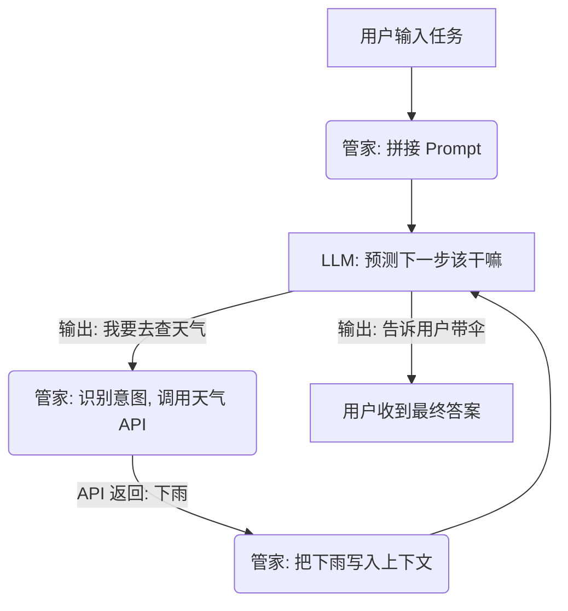

# 大白话拆解 LLM Agent：从「概率复读机」到 ReAct 框架

> [!IMPORTANT]
> **本文探讨的核心问题：**
> 1. LLM 本质上是一个「预测下一个 token」的模型，它并没有“意图”也没有“状态”。那 Agent 的“自主决策”和“多步推理”是怎么从这个机制里涌现出来的？
> 2. ReAct 框架解决了什么问题？

你提了一个非常深刻的问题。LLM（大语言模型）本质上确实只是一个**无状态、无意图的“概率复读机”**，它每天唯一做的事就是：根据你给它的上一段话，猜测后面最可能出现的词（Token）是什么。

那为什么这样一个“文字接龙游戏”，能摇身一变成为会“自主决策”、能“多步推理”的智能 Agent 呢？这背后的魔术究竟是怎么变出来的？

这篇文章将用最通俗易懂的语言、生活中的生动比喻，为你彻底拆解这背后的奥秘，并带你理解 **ReAct 框架** 到底拯救了什么。

---

## 一、 健忘的“复读机”，怎么就学会了“深度思考”？

要让一个只会“预测下一个 Token”的 LLM 展现出“自主决策”和“多步推理”，主要依靠两个核心魔法：**草稿纸效应（CoT）** 和 **外置备忘录（Agent 状态循环）**。

### 1. 草稿纸效应：把“一步登天”变成“按部就班”
**比喻**：如果你让一个数学大师在脑子里直接心算 `348 * 293 = ?`，他可能一下子也答不上来。但如果你给他一张**草稿纸**，让他一步步写出乘法竖式，他就能轻松算出来。

对 LLM 来说，**它自己输出的字，就是它的“草稿纸”**。

*   **没有草稿纸时**：如果你问 LLM：“小明有3个苹果，小红比他多2个，小东是小红的2倍，小东有几个？”
    如果直接让模型预测最后一个词（答案），它大概率会瞎猜一个数字。因为一步到位的概率计算太难了。
*   **有了草稿纸时（Chain of Thought, 思维链）**：我们引导它说：“请一步步想”。
    1. LLM 预测出第一句：“小红的苹果数是小明的 3+2 = 5 个。”
    2. **关键来了**：当 LLM 开始预测下一句时，**上面写下的那句话已经变成了它新的输入上下文（Context）**！
    3. LLM 看着新的输入（包含刚才自己写的那一步），轻松预测出下一句：“小东的苹果数是小红的 2 倍，也就是 5 * 2 = 10 个。”
    4. 最终预测出：“所以小东有 10 个苹果。”

**这就是“多步推理”的本质**：LLM 本身并不具备一个独立的、在后台运转的“思考引擎”。它是通过**把中间推理结果写进上下文（变成文字）**，让复杂的决策任务降低为一系列简单的“基于前一步预测下一步”的局部问题。

---

### 2. 外置备忘录：用外部系统给模型装上“灵魂”与“状态”
LLM 是**无状态（Stateless）**的，它就像电影《记忆碎片》里的主角，每次你跟它说话，它都不记得过去发生了什么，只能靠眼前的照片和便签（上下文）来回忆。

**Agent 系统就是那个帮模型打理一切的“外部管家”**。

1.  **管家（Python 代码）**：保存着当前的任务状态，比如“已经执行了哪些步骤”、“工具返回了什么”。
2.  **大模型（LLM）**：只负责在每一次迭代中做“选择题”或“填空题”。
3.  **循环接力**：
    *   管家问 LLM：“我们要去北京旅游，现在有天气 API，你下一步想干嘛？”
    *   LLM 根据概率预测，吐出：“我想调用天气 API，参数是北京。”（**自主决策的体现**）
    *   管家截获了这句话，替 LLM 去调了 API，得到“晴天，25度”。
    *   管家把这个结果拼接到对话历史里，再次问 LLM：“刚才查了北京天气是晴天25度，你下一步想干嘛？”
    *   LLM 看着这段新历史，预测出：“既然是晴天，我建议穿短袖，任务完成。”

**这就是“自主决策”的本质**：LLM 并没有真正的“意图”，它只是在**不断阅读“当前状态描述”并预测“逻辑上最合理的下一步动作”**。是外部系统不断把它的预测付诸实施，并将结果喂回给它，从而在外界看来，它仿佛拥有了自主规划和执行的能力。

---

## 二、 ReAct 框架解决了什么问题？

在 Agent 演进的过程中，人们发现大模型有两种各走极端的毛病：

1.  **光想不做（Reasoning-only / CoT）**：
    脑子很聪明，会一步步推导。但是**闭门造车**，不知道外面的世界变成了什么样。如果问它“今天最火的科技新闻是什么？”，它只会用 2024 年甚至更老的训练数据在脑子里瞎编（幻觉）。
2.  **光做不想（Acting-only / Tool Use）**：
    只知道调工具。比如“帮我找一下适合今天穿的衣服”，它直接调用 `Get_Weather()` 和 `Search_Mall()`。但它缺乏逻辑思考，如果天气 API 返回了错误或者空值，它不知道怎么拐弯，只会傻傻地报错或者胡乱调用。

为了解决这个问题，华盛顿大学和 Google 提出了 **ReAct 框架（Reason + Act，边想边做）**。

### 1. ReAct 是如何运行的？
ReAct 强制要求大模型在执行任务时，按照 **Thought（想） -> Action（做） -> Observation（看）** 的循环来交替进行：

*   **Thought (理性思考)**：我现在的处境是什么？我下一步应该采取什么行动？
*   **Action (采取行动)**：我要调用什么工具？参数是什么？
*   **Observation (观察反馈)**：工具执行后，我看到了什么客观事实？

### 2. 实例对比：寻找“杨幂老公的年龄”
假设我们要问 Agent ：“杨幂前夫现在的年龄是多少？”（假设模型训练数据里没有直接存这个时效性信息，且前夫已离婚，关系较复杂）。

#### ❌ 没有 ReAct（只有 Action）
*   **Action**: 搜索 "杨幂前夫的年龄"
*   **Observation**: 搜索结果很多乱七八糟的八卦，没有直接写年龄。
*   **Action**: 再次搜索 "杨幂前夫的年龄"（陷入死循环，因为没有 Thought 去分析为什么找不到，无法调整策略）。

####  使用 ReAct 框架
*   **Thought**: 我需要先确认杨幂的前夫是谁。
*   **Action**: `Search[杨幂 前夫]`
*   **Observation**: 搜索结果显示：“杨幂与刘恺威于 2018 年离婚...”
*   **Thought**: 确认杨幂前夫是刘恺威。现在我需要知道刘恺威的出生日期或年龄。
*   **Action**: `Search[刘恺威 生日]`
*   **Observation**: 搜索结果显示：“刘恺威，1974年10月13日出生于香港...”
*   **Thought**: 刘恺威是 1974 年出生的。现在是 2026 年，所以他的年龄应该是 2026 - 1974 = 52 岁。我已经得到了答案。
*   **Action**: `Finish[52岁]`

---

### 3. ReAct 框架具体解决了什么痛点？

#### ① 解决“幻觉”与“时效性”问题（通往现实世界的桥梁）
单纯的推理（CoT）容易让模型“一本正经地胡说八道”。ReAct 引入了 `Observation`（观察），强迫模型在每一步推理后，**必须低头看一眼现实世界的数据**。这就好比给蒙眼摸象的人配了一根盲杖，走一步戳一下，确保没跑偏。

#### ② 动态纠错与调整能力（带反馈的闭环系统）
如果某一次 Action 返回了错误信息（比如 API 报错了，或者搜索引擎没找到结果），在下一个 `Thought` 阶段，模型能够意识到“哦，刚才那一步搞砸了，我得换个方法”。
*   *Thought*: “刚才搜‘张三’重名太多，我应该加上他的职业‘张三 导演’重新搜一下。”

#### ③ 极佳的可解释性（Debug 友好）
对于人类用户和开发者而言，ReAct 打印出的日志就像是**大模型的思考切片**。你能清晰地看到：
*   它是怎么理解任务的（Thought）
*   它用了什么工具（Action）
*   它是怎么被外部信息“说服”或“修正”的（Observation）
这极大地降低了调试 Agent 系统的难度。

---

## 三、 总结一句话

*   **涌现的本质**：LLM 没脑子也没记忆，但我们用 **“把中间思考过程写成文字（CoT）”** 的方式给它造了一张草稿纸，再用 **“外置循环系统”** 帮它做接力，从而涌现出了自主决策和多步推理的假象。
*   **ReAct 框架**：通过强制 **“边想 (Thought) 边做 (Action) 边看 (Observation)”**，把大模型的内部逻辑推理与外部世界的实时反馈严密结合在了一起，彻底解决了 Agent 闭门造车（幻觉）和鲁莽行动（无脑）的通病。
